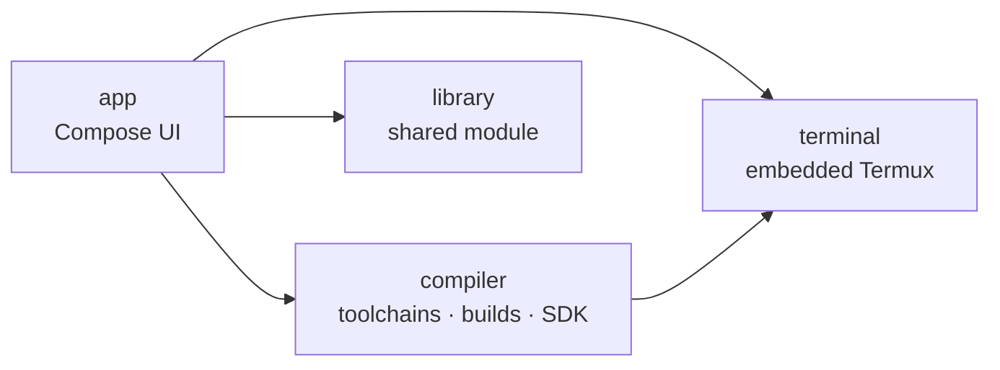

<div align="center">

# Kotnya

### A Kotlin IDE that fits in your pocket

Write, build and install Android apps on the device itself — no laptop, no cloud build, no root.

[](https://www.android.com)
[](https://kotlin-toolchain.org/dev/)
[](https://developer.android.com/jetpack/compose)
[](https://termux.dev)

</div>

---

Kotnya embeds Termux, a Java runtime, a Kotlin Toolchain and the Android SDK manager into
one Android app. The first launch walks you through installing each piece with a couple of taps; after
that you create a project, edit it, hit **Build**, and watch the APK install itself.

Everything runs locally in the app's private storage. There is no remote build service and nothing to
set up on a computer.

## ✨ Features

- **📊 Android SDK dashboard** — browse every platform, build-tools and command-line tools release,
  each platform shown with its Google Play device-usage share, and install the ones a project needs.
- **🧰 Kotlin Toolchain manager** — installs the same `kotlin-cli` distribution the desktop wrapper
  uses, keeps several versions side by side and lets you switch between them.
- **📝 Tabbed editor** — open, edit and save files with unsaved-change tracking, plus a build log pane.
- **⚡ One-tap build & install** — runs the toolchain tasks, finds the produced APK and hands it to the
  system installer.
- **🐚 Real terminal** — an embedded Termux terminal emulator (a real PTY, not a fake console) rooted at
  the project directory.
- **📦 Project templates** — a console app that runs on-device, or an Android app that produces an APK.

## 🚀 Getting started

Kotnya is built with the [Kotlin Toolchain](https://kotlin-toolchain.org/dev/). The `kotlin`
(macOS/Linux) and `kotlin.bat` (Windows) scripts in the project root are self-bootstrapping wrappers:
they download the pinned toolchain — **0.13.0** — and a JRE on first use, so no separate installation
is required.

```bash
# Clone the repository
git clone <repository-url> && cd kotnya

# Build every module (first run downloads the toolchain)
./kotlin build

# Install the app on a connected device
./kotlin run -m app

# Run the unit tests of one module
./kotlin test -m compiler
```

**What you need:** a connected Android device or emulator running Android 8.0+ and an Android SDK
(compile target `android-37`). Everything below that is provisioned by the wrapper.

## 📊 SDK dashboard

Instead of asking for a zip URL, Kotnya reads the vendors' own indexes:

- **Platforms** — every `platforms;android-XX` package with a bar showing its share of active Google
  Play devices, so picking a `compileSdk`/`targetSdk` is an informed choice.
- **Build tools** — all published versions, newest first.
- **Command-line tools** — every release, downloaded and unpacked directly (no `sdkmanager` bootstrap
  chicken-and-egg).
- **Termux bootstraps** — the published archives for this device's ABI, newest first.

Device usage comes bundled from Google's [distribution dashboard](https://developer.android.com/about/dashboards)
(snapshot: 28 days ending November 24, 2025); Google does not expose it as an API, so the table is
refreshed by hand in `AndroidDistribution.kt`.

## 🏗 Architecture



| Module | Targets | Responsibility |
| --- | --- | --- |
| [`app`](app) | Android | Compose Material 3 UI, onboarding, editor, build log, settings |
| [`compiler`](compiler) | Android + JVM | Version catalogue, Kotlin Toolchain and Android SDK management, compiler runs, project generation |
| [`terminal`](terminal) | Android | Termux bootstrap installation, PTY terminal sessions, shell execution with the Termux environment |
| [`library`](library) | Android | Shared module reserved for cross-module code |

The `compiler` module keeps its project generation and SDK paths on the JVM target too, so they are
unit tested without a device.

## 📁 Project layout

```text
.
├── app/                    # Android application (Compose UI)
├── compiler/               # Toolchain, SDK and build orchestration
│   ├── src@android/
│   ├── src@jvmAndAndroid/
│   └── test@jvm/
├── terminal/               # Termux bootstrap, PTY sessions, shell
├── library/                # Shared module
├── kotlin                  # Self-bootstrapping toolchain wrapper (macOS/Linux)
├── kotlin.bat              # Self-bootstrapping toolchain wrapper (Windows)
├── project.yaml            # Kotlin Toolchain project definition
└── libs.versions.toml      # Dependency versions
```

## 🧪 Testing

```bash
./kotlin test                 # every module
./kotlin test -m compiler     # a single module
```

## ⚠️ Known limitations

- `targetSdk` is pinned to **28**: Termux binaries are executed from the app's private data directory,
  which Android 10+ blocks for apps targeting API 29 or later. Raising it requires a different exec
  strategy.
- Device-usage percentages are a bundled snapshot, not live data.
- The bootstrap release list uses the unauthenticated GitHub API (60 requests/hour per IP); the list is
  cached in memory for the session.
- Updating an existing Termux bootstrap currently requires uninstalling it first.
- `library` is a placeholder module and currently contains no code.

## 🤝 Contributing

Issues and pull requests are welcome. For larger changes, open an issue first so the approach can be
discussed. Keep the existing module boundaries: UI in `app`, toolchain and SDK logic in `compiler`,
process and PTY handling in `terminal`.

## 💜 Acknowledgements

Kotnya stands on the shoulders of [Termux](https://termux.dev),
[Kotlin](https://kotlinlang.org), [Jetpack Compose](https://developer.android.com/jetpack/compose) and the
[Kotlin Toolchain](https://kotlin-toolchain.org/dev/).

---

<div align="center">

Built with the [Kotlin Toolchain](https://kotlin-toolchain.org/dev/) · Runs entirely on your device

</div>
